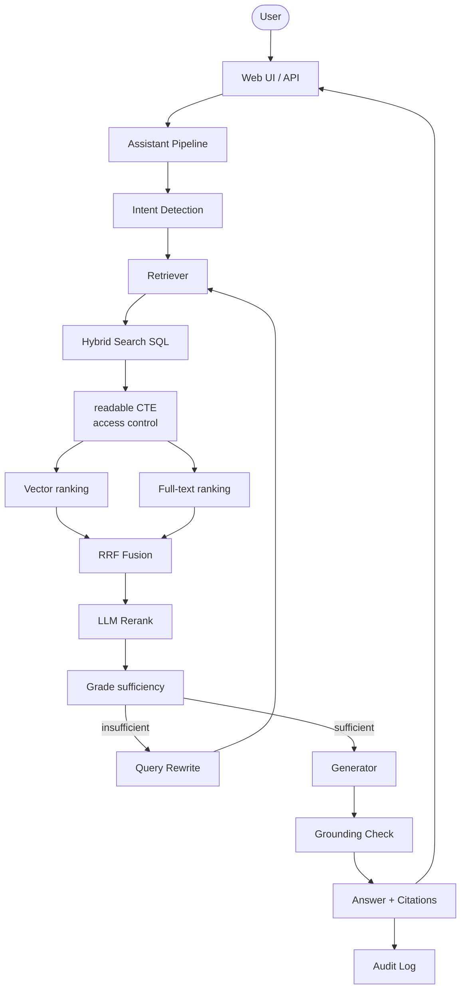

# Secure Enterprise RAG Assistant

Production-style Retrieval-Augmented Generation system with **access control enforced in SQL**, hybrid search, corrective RAG, and grounded answers.

Built as part of the Telusko Agentic AI Engineering with Python course (session 10-10-2026).

## Features

- Hybrid search (vector + full-text) with Reciprocal Rank Fusion
- Per-user access control applied **before** ranking (`public` / `internal` / `restricted`)
- Corrective RAG: intent detection → grade → query rewrite → retry
- Grounded answers with exact-quote verification
- Full audit log of every question
- FastAPI + minimal web UI
- Fully containerized (Postgres + pgvector + app)

## Architecture



## Access Control Model

| Visibility   | Who can see it                  |
|--------------|---------------------------------|
| `public`     | Anyone (including guests)       |
| `internal`   | Any employee                    |
| `restricted` | Only the matching department    |

The filter lives in the `readable` CTE. A forbidden document is never ranked and never sent to the model.

## Quick Start

```bash
# 1. Clone the repository
git clone https://github.com/yash9614/project_oo1.git
cd project_oo1

# 2. Create .env
echo "OPENAI_API_KEY=sk-your-key" > .env

# 3. Start everything
docker compose up --build
```

Open http://localhost:8000

- Switch between **Alice** (engineering) and **Bob** (HR)
- Ask “Who may push to production?”
- Alice receives a grounded answer; Bob is escalated

## Project Structure

```
.
├── assistant/          # pipeline, retrieval, generation, repository, API
├── prompts/            # answer, grade, intent, rewrite, rerank
├── sample-documents/   # example policies
├── web/                # index.html
├── schema.sql
├── docker-compose.yml
├── Dockerfile
├── ask.py             # CLI entry point
└── pyproject.toml
```

## Key Design Decisions

- Access control is a SQL predicate, not a Python filter after retrieval.
- Grounding is verified by string match on the quoted sentence, not by asking the model.
- Documents are identified by content hash, not filename.
- One Postgres holds vectors, full-text index, metadata, and the audit trail.

## Bonus Material

See [CONCEPTS.md](CONCEPTS.md) for important concepts and interview-style Q&A.
